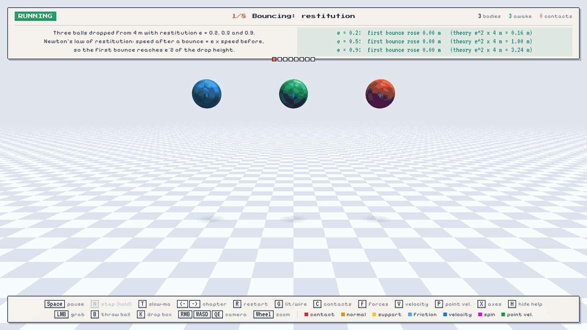
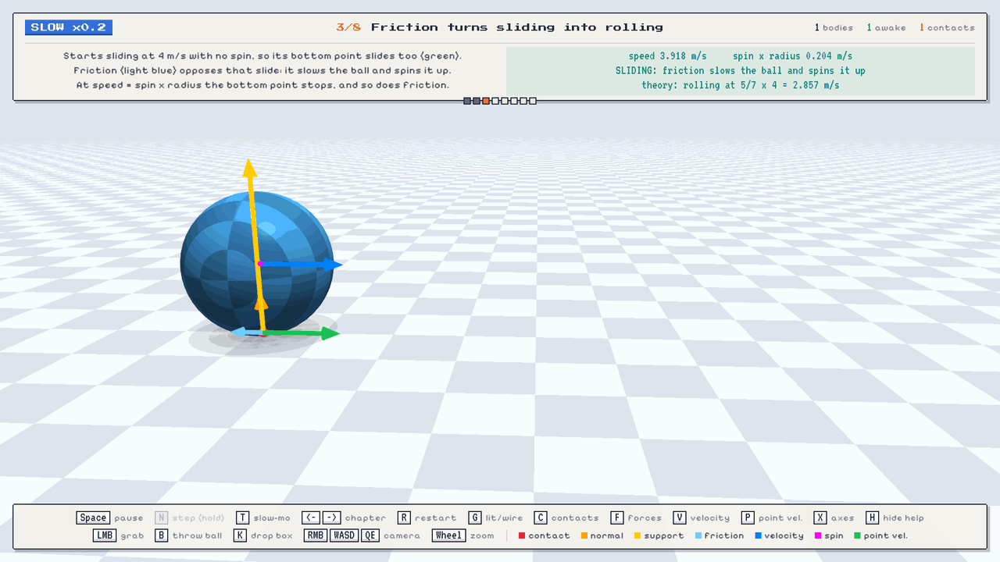

# phyX



phyX is a small 3D rigid-body physics engine written in C++20, with an interactive demo built on [raylib](https://www.raylib.com/). It simulates linear and rotational motion, detects collisions between primitive shapes, and resolves them with a sequential impulse solver. The demo walks through the physics chapter by chapter, drawing the forces and velocities the solver works with.

> **Work in progress:** phyX is an experimental project. The engine and demo are intended for learning and exploration, not production use.

## Features

**Engine**

- **Rigid-body motion** with gravity, linear and angular momentum, quaternion orientation, and shape-based inertia.
- **Collision detection** for sphere–sphere, sphere–AABB, sphere–OBB, AABB–AABB, AABB–OBB, and OBB–OBB pairs, plus sphere, AABB, and OBB collisions against planes.
- **Contact manifolds** with up to four contact points per pair, one shared normal, and a depth for each point.
- **Sequential impulse solver** with 10 passes per step, warm starting from the previous step's impulses, restitution (Newton's law), friction, and rolling resistance.
- **Sleeping:** bodies that stay still for 0.5 s stop being simulated until something touches them.

**Demo**

- **Eight guided chapters:** restitution, contact-point velocity, friction turning sliding into rolling, rolling resistance, contact manifolds, stacking, sleeping, and free play. Each chapter has its own scene, caption, and live numbers to compare against theory.
- **Overlays** for contact points, normals, support and friction forces, body velocity and spin, contact-point velocity, and body axes.
- **Interaction:** grab bodies with the mouse, throw balls, drop boxes, pause, single-step, and slow motion.
- **Two looks:** lit and textured with soft shadows, or wireframe.



## Build and run

Requirements: CMake 3.14 or newer and a C++20 compiler. CMake downloads raylib 5.5 during the first configuration, so that step needs network access.

```sh
cmake -S . -B build
cmake --build build --config Debug
```

Run the executable from the build directory:

```sh
# Linux / macOS, or single-configuration generators such as Ninja
./build/phyX

# Windows with Visual Studio
.\build\Debug\phyX.exe
```

For a different configuration, replace `Debug` with `Release` in the Windows executable path. The build copies `assets/` (fonts) next to the executable.

## Controls

| Input | Action |
|---|---|
| Space | Pause / resume |
| N | Step once while paused (hold to keep stepping) |
| T | Slow motion (x0.2) |
| ← / → or 1–8 | Previous / next chapter, or jump to one |
| R | Restart the chapter |
| G | Lit / wireframe look |
| C / F / V / P / X | Contacts / forces / velocities / point velocities / axes |
| H | Hide / show the key help |
| Left mouse | Grab a body; release to throw it |
| B / K | Throw a ball from the camera / drop a box where you point |
| Right mouse + move | Orbit the camera |
| Right mouse + W / A / S / D, Q / E | Move the camera, down / up |
| Scroll wheel | Zoom |

The simulation advances at a fixed 120 steps per second; rendering runs independently.

## Project layout

```text
src/
├── math/                     # phyx_math (header-only): Vec3, Quaternion, Mat3
├── physics/                  # phyx_core
│   ├── Engine.h / .cpp       # Body creation, collision detection, solver, sleeping
│   ├── bodies/               # RigidBody, Inertia, Shape, BodyDesc
│   └── collision/            # Sphere, AABB, OBB, and plane tests; contact data
├── demo/                     # the phyX executable
│   ├── main.cpp              # Main loop: input, fixed-step physics, drawing
│   ├── app/                  # Demo state, key handling, mouse grab / throw / drop
│   ├── chapters/             # The guided chapters: scenes, captions, live readouts
│   ├── render/               # raylib rendering: lit shader, bodies, overlays
│   └── hud/                  # Theme (fonts, colours, panels) and HUD layout
└── tests/
    └── MathTests.cpp         # Console math sanity checks
assets/fonts/                 # Pixel fonts used by the HUD
```

## Credits

- [raylib](https://www.raylib.com/) for windowing and rendering.
- Fonts, all under the SIL Open Font License (licence files in `assets/fonts/`):
  - [Press Start 2P](https://fonts.google.com/specimen/Press+Start+2P)
  - [Pixelify Sans](https://fonts.google.com/specimen/Pixelify+Sans)
  - [VT323](https://fonts.google.com/specimen/VT323)
